# AnyTogether

The online home of the AnyPS5 launchers: profiles, trophies, friends, parties, voice, messages,
share play, leaderboards, themes and downloads, at https://anytogether.kodla.agency.

The plan lives on the `anytogether` branch of
[AnyPS5-ARM](https://github.com/AnyTogether/AnyPS5-ARM/tree/anytogether) (English and Turkish).

## Screenshots

The website, with made-up demo people and data.

| Home | Profile |
|---|---|
| 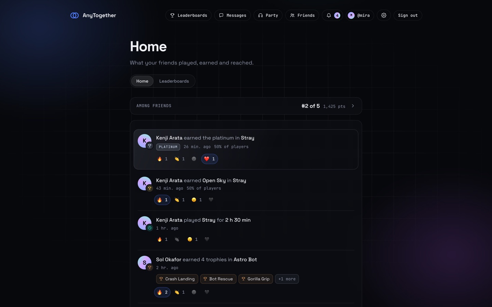 | 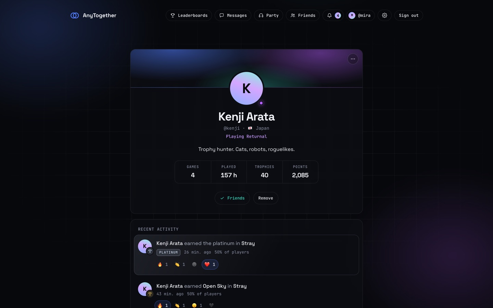 |
| **Messages** | **Party** |
| 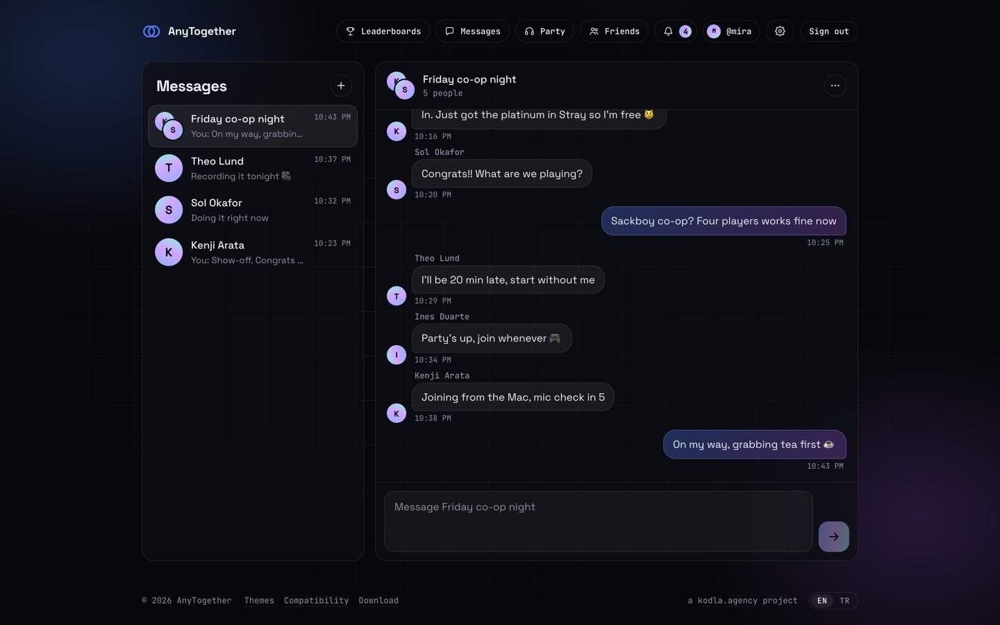 | 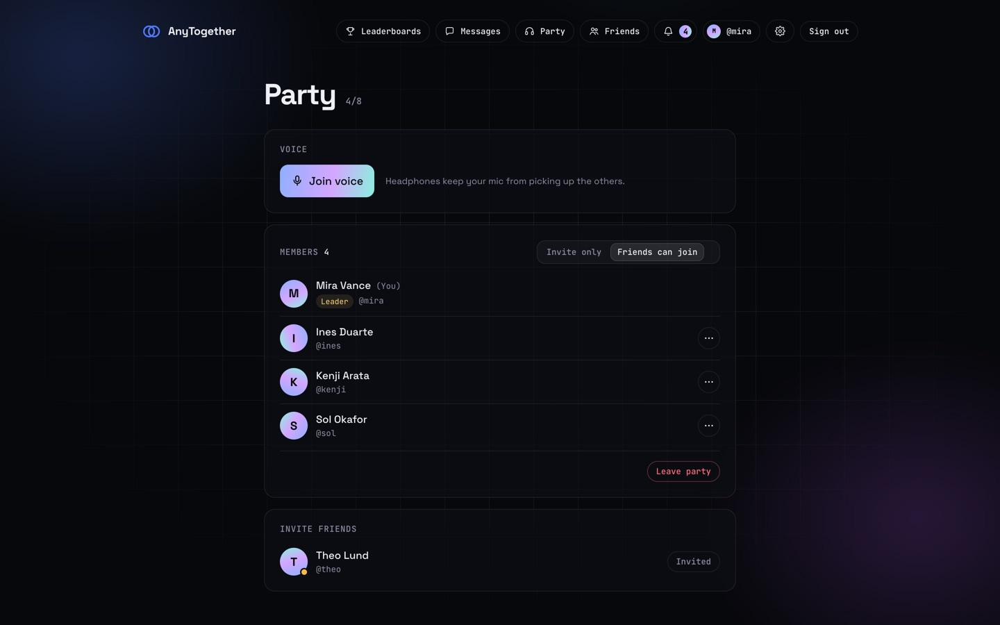 |
| **Leaderboards** | **Themes** |
| 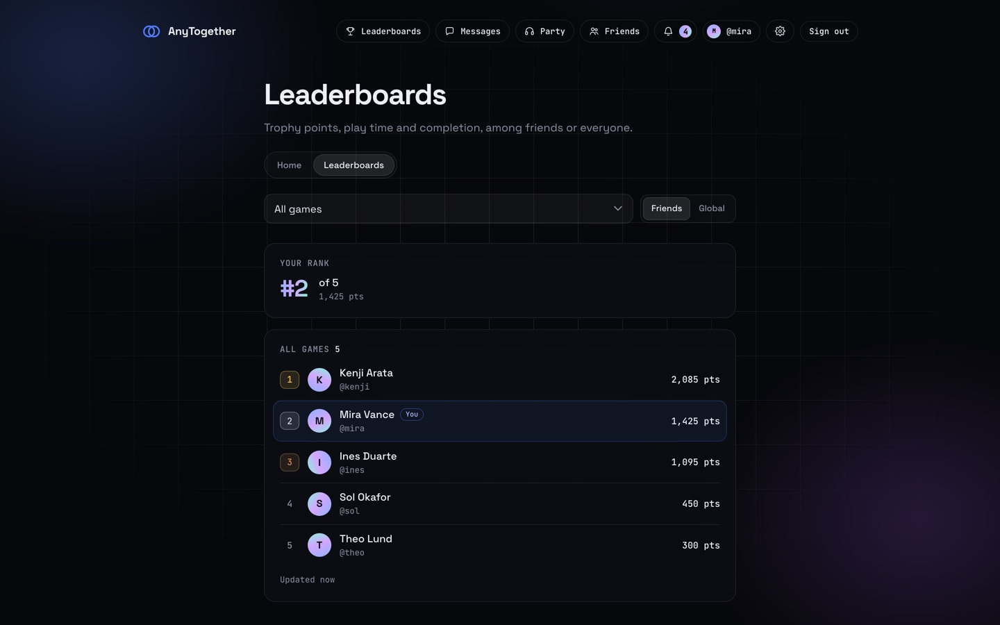 | 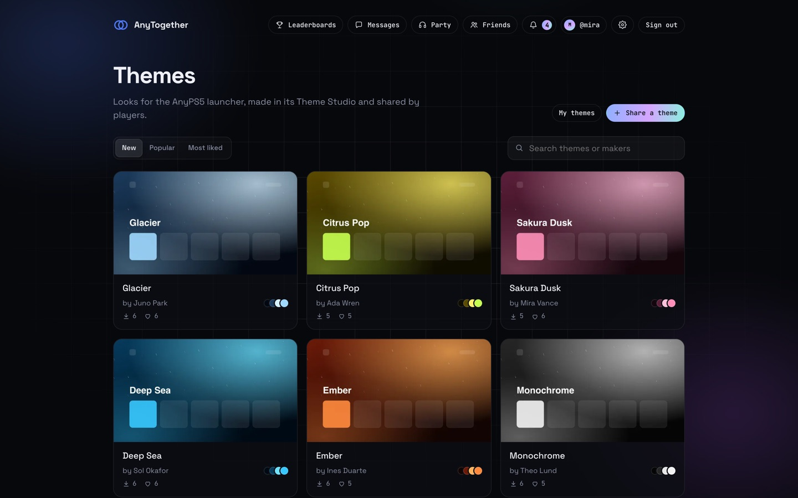 |
| **Compatibility** | **Download** |
| 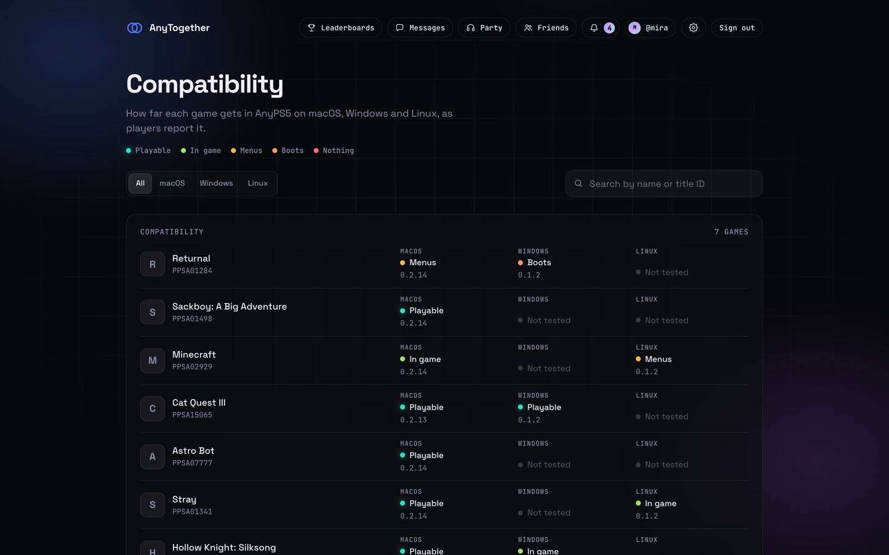 | 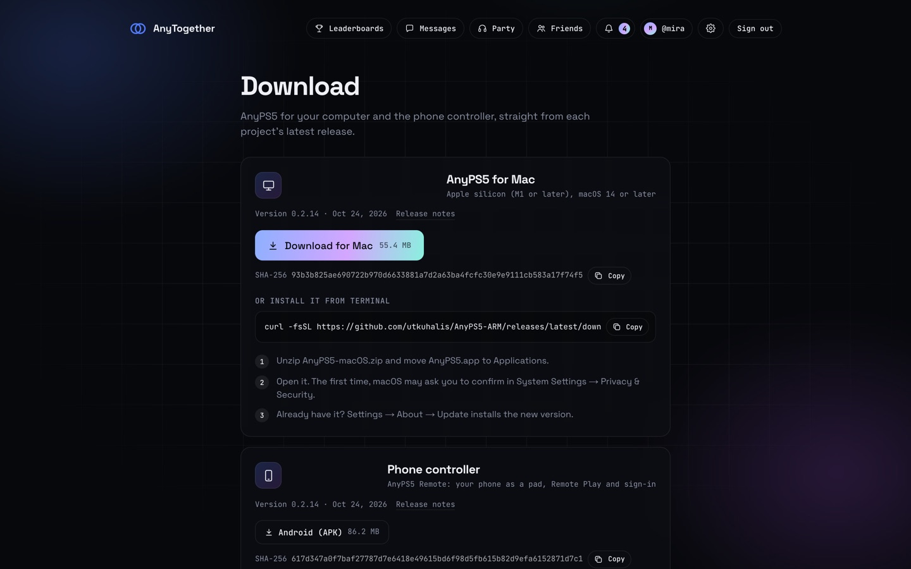 |
| **Photos, clips and voice notes** | **Profile gallery** |
| 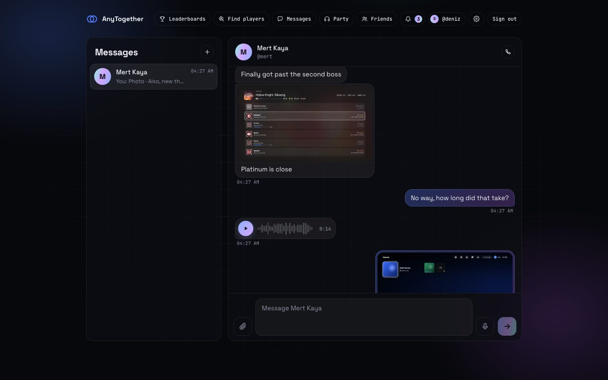 | 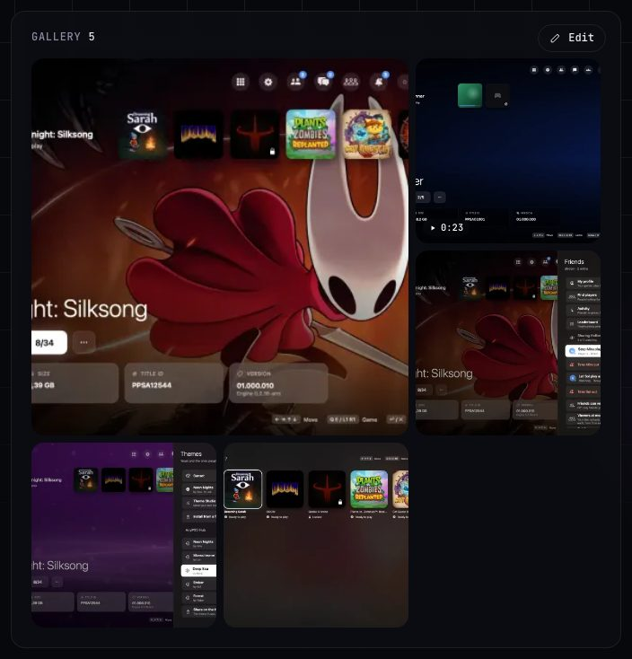 |
| **Settings → Storage** | |
| 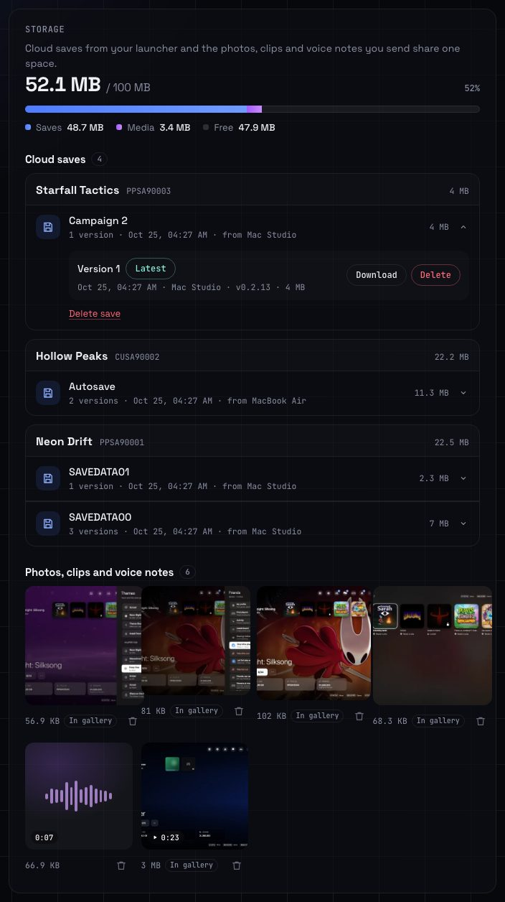 | |

On a phone:

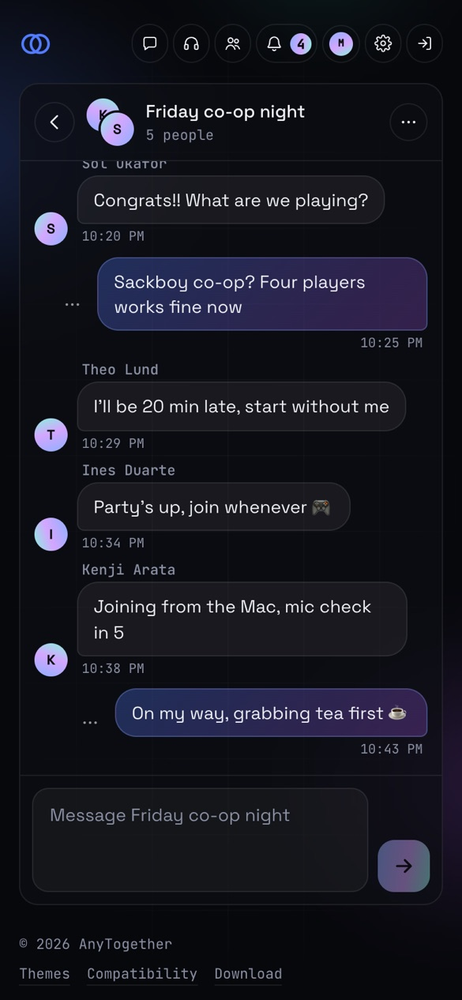

## Layout

- `apps/api`: the REST API (`/api/v1`), TypeScript and Hono
- `apps/realtime`: the WebSocket gateway (`/rt`): presence, messages, signalling
- `apps/worker`: background jobs (pg-boss)
- `apps/backup`: scheduled, encrypted backups of the database and files to any rclone target, and
  restores ([docs/self-hosting.md](docs/self-hosting.md#backups))
- `packages/shared`: schemas, error codes, gateway events
- `packages/db`: Drizzle schema and SQL migrations
- `infra/`: local development services and the Dockerfiles
- `deploy/`: Docker Compose for running your own AnyTogether ([docs/self-hosting.md](docs/self-hosting.md))
- [docs/cloud-storage.md](docs/cloud-storage.md): the API for cloud saves and media (off until the
  server has a folder or a bucket for them)
- [docs/private-identity.md](docs/private-identity.md): the public ID and the friends-only name and
  picture, and when the API returns them

## Clients

Every AnyPS5 client talks to the same API and gateway, and they are tested together against one
real server (`e2e/`, last run 2026-10-24: every check passed).

| | macOS launcher | Phone (iOS, Android) | Windows/Linux launcher | Website |
|---|---|---|---|---|
| Sign-in: email code, passkey via the website, one tap from the phone | ✅ | ✅ | ✅ | ✅ |
| Friends and presence | ✅ | ✅ | ✅ | ✅ |
| Messages and group chats, typing | ✅ | ✅ | ✅ | ✅ |
| Parties | ✅ | ✅ | ✅ | ✅ |
| Voice chat and 1:1 calls, mute | ✅ | ✅ | ✅¹ | ✅ |
| Play time and trophies sync | ✅ | – | ✅ | ✅ (profiles) |
| Joining a friend's game | ✅ | – | ✅ | – |

"–": not a feature of that client. ¹ Built, not yet part of the cross-client run. The clients: [AnyPS5-ARM](https://github.com/AnyTogether/AnyPS5-ARM)
(macOS launcher, phone app), [AnyPS5-Desktop](https://github.com/AnyTogether/AnyLauncher-Port) (Windows
and Linux). How to run the cross-client checks: [e2e/README.md](e2e/README.md).

## Development

```sh
pnpm install
pnpm dev:db                       # PostgreSQL and Valkey on the loopback (Docker)
pnpm --filter @anytogether/db migrate
pnpm test
```

## Running your own

`deploy/` runs the whole thing on one machine with `docker compose up -d`: PostgreSQL, Valkey, the
API, the gateway, the website, Caddy with automatic HTTPS, and optionally a TURN relay and
off-site backups (S3, Google Drive, SFTP and more). See
[docs/self-hosting.md](docs/self-hosting.md).

## Credits

**The core**

- **[AnyPS5](https://github.com/boykopovar/AnyPS5) by boykopovar** is where the core comes from: the relinker that turns a PS5 executable into a native program and the reimplemented system libraries. AnyPS5-ARM is its port to Apple silicon Macs, and every engine feature here starts from that work.
- **[mugurc's community macOS port](https://github.com/mugurc/AnyPS5/tree/macos-port)** of AnyPS5 is the port AnyPS5-ARM builds on.
- **[MoltenVK](https://github.com/KhronosGroup/MoltenVK)** (Khronos, Apache-2.0) runs the PS5 graphics driver's Vulkan on Metal, and **[SDL](https://github.com/libsdl-org/SDL)** (zlib) reads the controllers in games and in AnyLauncher Port.

**Online play**

- **The online design comes from [AnyPlay](https://github.com/anyplaynet).** Our bridge between the engine and the launcher follows AnyPlay's bridge spec ([anyplaynet/network](https://github.com/anyplaynet/network/blob/main/spec/bridge-protocol.md), MIT/Apache-2.0): the frame header, the message numbering, the virtual LAN range and the A/B/C screening of games come from it. Stream P2P sockets over the bridge follow the approach of AnyPlay's engine bridge ([anyplaynet/AnyPS5](https://github.com/anyplaynet/AnyPS5), GPL-2.0).
- **Ideas AnyPlay shipped first** ([anyplaynet/launcher](https://github.com/anyplaynet/launcher), [anyplaynet/cloud](https://github.com/anyplaynet/cloud)): "Try anyway" on a Play Together version mismatch, retiring old launchers with "Update required", asking before leave party / remove friend and similar actions, the noise suppression switch, the public profile switch and the compatibility filters.
- **A phone browser as a controller via a QR code** comes from [LudusCtrl](https://github.com/parl0v/ludusctrl)'s browser client by Josip Parlov (@parl0v), shipped in AnyPlay.

Our code is written independently; where we followed someone's design or idea, it is named here.

## License

MIT (see `LICENSE`).
